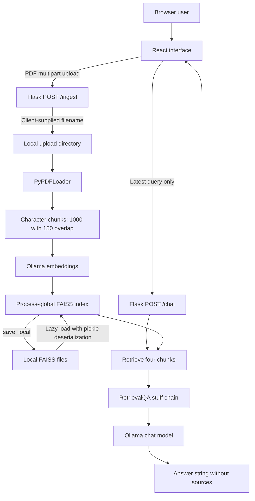
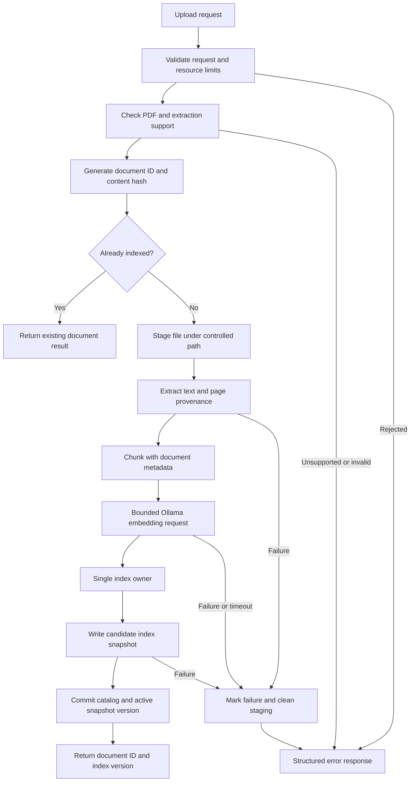
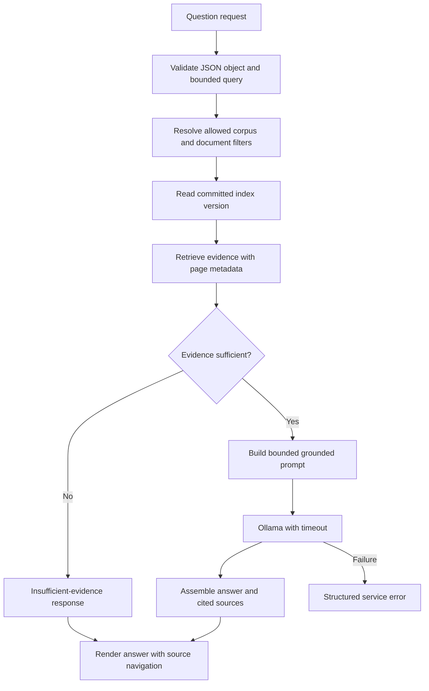
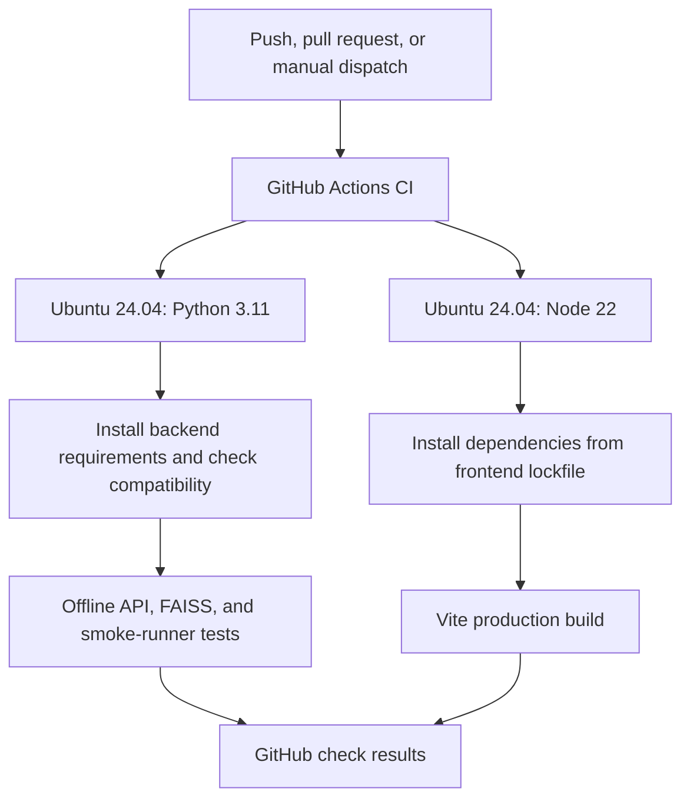

# Application flows

Date: 2026-10-19

This document distinguishes implemented behavior from planned behavior.
See [decisions](decision.md) and [delivery plan](plan.md).

## Current implementation

The browser stores displayed messages in React state. The backend receives no
conversation history. All uploads share the same index. Uploaded PDF presence
does not mean it has been indexed. Health reports index availability, not model
readiness. Compose mounts uploads and index storage; Kubernetes currently does
not. Remote Ollama endpoints are configurable.

## Proposed ingestion flow — not implemented

The commit protocol must specify recovery from interruption between catalog and
snapshot updates. Queries see a committed version. Ingestion failures leave the
previous committed corpus usable. For the first implementation, ingestion stays
synchronous with bounded requests; background jobs are deferred unless measured
processing time requires them.

## Proposed question flow — not implemented

Initially, corpus scope is the explicitly local single-user corpus. Shared-host
scope must be derived from authenticated authorization, never a client-supplied
tenant identifier alone. Evidence-sufficiency rules require benchmark validation;
no confidence threshold is claimed to be effective yet.

Conversational query rewriting is a later extension before retrieval. It must
preserve document scope and must not turn previous model answers into evidence.

## Proposed operational boundaries — not implemented

- Browser requests have cancellation and bounded waiting behavior.
- API responses use stable error codes and safe user-facing messages.
- Liveness checks process responsiveness; readiness checks committed storage,
  Ollama connectivity, and required model availability with bounded checks.
- Compose owns local model initialization and persistent mounts.
- Kubernetes uses persistent volumes and a declared model-serving endpoint.
- Logs correlate requests and durations without retaining financial text by
  default. Backup/restore covers uploads, catalog, and index versions together.

## CI verification flow — configured, hosted execution unverified

The [GitHub Actions workflow](../.github/workflows/ci.yml) configures this
verification path. It does not change the application request flows above.

Jobs use disposable hosted runners and dependency download caches. Tests use
synthetic data and temporary corpus storage. CI does not start Ollama, pull
models, publish build artifacts, or deploy containers. Real-model checks remain
an explicitly invoked local verification path.

## Maintenance log

- 2026-10-19: Documented the inspected implementation and separately labeled
  proposed flows. No runtime flow changed. Reviewed against source paths in
  `backend/app.py`, `backend/rag_pipeline.py`, `frontend/src/api.js`, Compose,
  and Kubernetes manifests. Diagram rendering remains to be verified in a
  Mermaid-capable viewer.
- 2026-10-19: Reviewed Phase 0 verification tooling. API tests replace the RAG
  module and redirect uploads to temporary storage. The opt-in smoke runner
  copies the two backend modules to a temporary directory and starts distinct
  ingest and reload processes using real Ollama; it never pulls models. These
  are verification paths, not changes to the application flows above.
- 2026-10-19: Reviewed final Phase 0 changes against the diagrams. Added a real
  PDF/FAISS offline persistence test with fixed model substitutes; this does not
  measure model retrieval quality or real process-restart behavior. The
  [baseline report](baseline.md) records the unavailable real Ollama preflight.
  Runtime diagrams remain unchanged.
- 2026-10-19: Added the configured CI verification flow on GitHub-hosted Ubuntu
  runners. Reviewed current application and planned flows; no runtime component
  or persistence changes. Local command and workflow validation are documented
  in [baseline.md](baseline.md). The first hosted run and Mermaid rendering are
  not claimed as verified.
